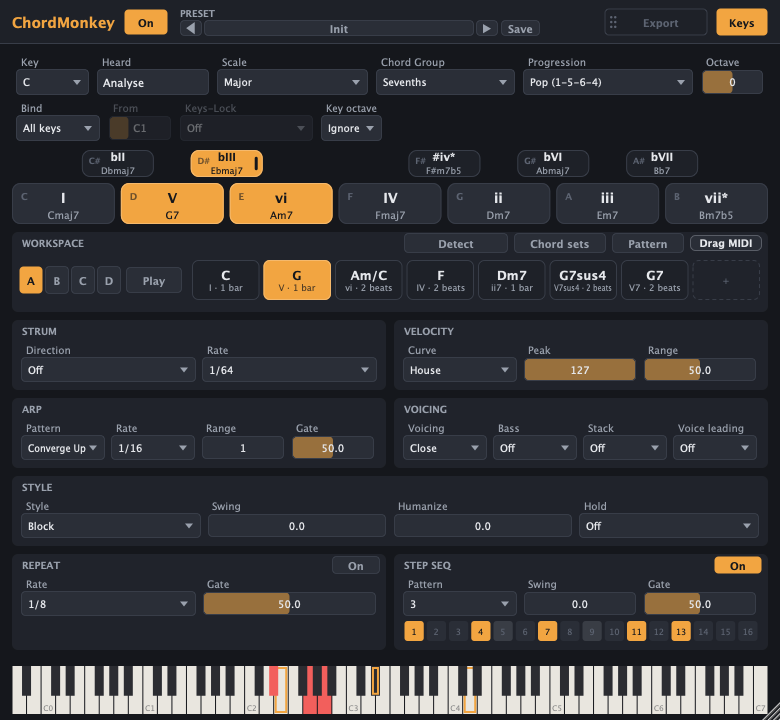

# ChordMonkey

A MIDI chord workstation plug-in (VST3) for Ableton Live on macOS, after the manner of a simplified
Scaler 2: a scale's chords, chord sets, patterns of chords that play in time with Live, Bind and
Keys-Lock, Detect, substitutes, and drag-out to MIDI clips. It's a fork of
[ChordChimp](../chordchimp); the plan and its status are in [PLAN.md](PLAN.md).



**Status:** all ten phases of [PLAN.md](PLAN.md) are done (2026-11-04), each checked in Live 12.4.16
through the Ableton MCP bridge and by hand.

## What it does

- **Palette.** The chord pads are the Key's scale chords (I–VII) and five borrowed chords
  (bII, bIII, #iv°, bVI, bVII), shaped by the Chord Group (triads to 13ths) and the Progression.
  Click a pad, or play a key: with Bind on **All keys** (the default) every white key plays its
  chord and the black keys the borrowed ones, as in ChordChimp.
- **Workspace.** Four patterns (**A–D**) of up to eight chords each, saved with the Live set and
  in presets. Drag a pad onto a slot (or right-click a pad) to add its chord; click a slot to hear
  it, drag it to reorder, right-click it for its length, inversion, octave, **substitutes**,
  duplicate and delete. **Pattern ▾** transposes to the Key, copies and clears.
- **Play.** The current pattern plays in time with Live, through the performance: Voicing (Close,
  Open, Spread, Wide), Bass (the chord's bass note, E under C/E, with or without the root's 5th), 17 rhythm **Styles** with Swing and Humanize, and
  ChordChimp's Strum, Arp, Repeat, Step seq, Velocity, Hold and voice leading. A pattern change
  waits for the next bar.
- **Chord sets.** 41 factory progressions in six categories (Pop, Rock, Jazz & Soul, EDM & House,
  Cinematic, Moods), loaded into a pattern in the current Key, optionally with their suggested
  Scale and Style; save your own patterns as chord sets. The 10 **Songwriting** presets (Pop
  Writer, Neo-Soul, House, Cinematic, Rock, Jazz, Ballad, Lo-Fi, Reggae and Latin Sessions) fill
  the workspace: pick one and press Play.
- **Bind and Keys-Lock.** Bind puts the pattern's slots (or the palette) on one octave of keys
  from **From** (white keys the slots, C# D# F# G# patterns A–D, A# silence); the keys above play
  **Keys-Lock**: scale notes mapped, scale notes only, scale white keys, chord notes, or chord
  extensions (the chord with its 9th, 11th and 13th), so a melody stays in the key or on the chord.
- **Drag MIDI.** Drag the pattern onto a Live track: one loop, rendered with the performance, the
  same notes ChordMonkey plays. Hold Alt for the chords only.
- **Detect.** Press **Detect**, play chords (or let a clip play into ChordMonkey's track), then
  **Use n chords**: they become the pattern, inversions, extensions and lengths included, and Key
  and Scale follow the key heard. **Analyse** (Heard) guesses the key alone.
- **Substitutes.** A slot's right-click → Substitutes: the scale's chords a 3rd below and above,
  the parallel major or minor, sus2 and sus4, the 9th, the 7th and the tritone sub.

## In Live

1. Put ChordMonkey (Plug-Ins → VST3 → Alistair Rutherford) on a MIDI track: its *MIDI From* your
   keyboard, armed or monitoring *In*.
2. Put an instrument on another track with *MIDI From: the ChordMonkey track → ChordMonkey*.
3. Pick a Key and Scale, load a chord set or a Songwriting preset, and press **Play** while Live
   plays; or play the pads.

To capture a clip's chords: give ChordMonkey's track *MIDI From: the clip's track* (monitoring
*In*), press **Detect**, play the clip, then press **Use n chords**.

Every control is a host parameter (Live's Configure, automation, Push); the factory presets are
also the plug-in's programs. A set saved before a newer ChordMonkey keeps the parameter list it
was saved with: load the device again to see new parameters.

## Install

Needs Xcode (open it once after installing) and JUCE 8.0.14:

```sh
git clone --branch 8.0.14 https://github.com/juce-framework/JUCE.git ~/Development/JUCE
Tools/install.sh              # build, sign ad hoc, install for this user
```

`Tools/install.sh` builds the VST3 and the Standalone (Release, universal) in `dist/build`, signs
both ad hoc and installs `~/Library/Audio/Plug-Ins/VST3/ChordMonkey.vst3` and
`~/Applications/ChordMonkey.app` for the current user. `--juce DIR` for JUCE elsewhere,
`--validate` to run pluginval on the installed plug-in, `--uninstall` to remove both. Then rescan
plug-ins in Live (Settings → Plug-Ins, with *Use VST3 Plug-In System Folders* on).

ChordMonkey has its own bundle ID (`com.alistairrutherford.chordmonkey`), plug-in code (`Cmky`),
presets (`~/Music/ChordMonkey/Presets`) and chord sets (`~/Music/ChordMonkey/ChordSets`), so it
installs and loads next to ChordChimp and Chordism. It reads ChordChimp and Chordism preset files.

## Build (development)

```sh
PROJUCER=~/Development/JUCE/extras/Projucer/Builds/MacOSX/build/Release/Projucer.app/Contents/MacOS/Projucer
"$PROJUCER" --resave ChordMonkey.jucer
xcodebuild -project Builds/MacOSX/ChordMonkey.xcodeproj -target "ChordMonkey - All" -configuration Release build
```

The engine (`Source/core`) is plain C++ with no JUCE, so all of its behaviour is tested without a
host; `Source/plugin` and `Source/ui` are the JUCE adapter and editor.

## Test

```sh
Tests/run_tests.sh          # core tests (no JUCE): theory, engine, patterns, Bind, styles, Detect…
Tests/run_snapshot.sh       # editor snapshots, parameters, state, presets, no allocation
Tests/run_validation.sh     # pluginval strictness 10 on the installed VST3
Tests/run_bench.sh          # CPU per instance (8 instances, under 1% each)
```

Live-in-the-loop checks use the Ableton MCP plug-in (ClaudeLiveBridge, port 9873); see PLAN.md §7.
`.github/workflows/build.yml` runs the core tests, a clean install with pluginval, the snapshot
checks and the benchmark on a macOS runner.
